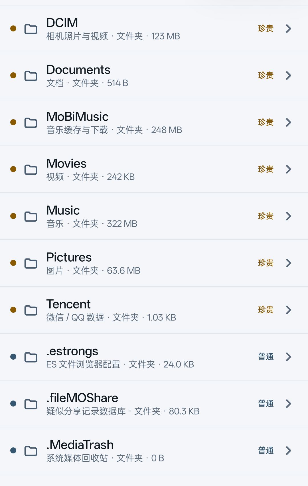

[简体中文](./README.md) · **English**

<div align="center">

<h1>Storage Atlas</h1>
<p>Gives every folder on your phone a plain-language Chinese note, so a wall of English directory names becomes a map you can read at a glance.</p>
<p>


</p>
</div>

Storage Atlas (存储星图) is a local storage browser for Android. It gives every directory and file a short Chinese note and an importance level, then hands that information to AI through the built-in MCP server: list directories, read file contents, write notes in bulk, change importance levels. Everything runs on the phone; no data leaves the device.

- Pure Java, no third-party dependencies, an 85 KB APK
- No Gradle: `./build.sh` produces the package in about a dozen seconds
- The entire UI is custom-drawn, with no AppCompat / Material component libraries



> Root directory listing: the colored dot on the left is the importance level; below each name are its Chinese note, size and modification time.

## What it does

| Feature | Description |
|---|---|
| Browse storage | Walk down from the internal storage root, showing size, child count and modification time; supports paging and sorting |
| Chinese notes | 70 common directory paths and 138 general-purpose words built in, and you can write your own; notes are stored by storage-relative path |
| Six importance levels | System / Precious / Project / Normal / Clearable / Unused, each shown as a colored dot plus a tag on the right; filter by level |
| Search | Search by file name, note or relative path, and narrow the results by directory and extension |
| Reading | Text is previewed inline (first 200 KB), images are shown as images, binaries report their format and size |
| Organizing | Create folders, rename, delete, add to favorites |
| Whole-storage stats | Counts of annotated and unannotated entries, cached for 5 minutes |
| AI interface | Built-in MCP server (JSON-RPC 2.0 over HTTP), 13 tools, tiered permissions |

## Why "Storage Atlas"

The Android root holds dozens of directories, most of them English abbreviations or package names: `Tencent/MicroMsg`, `Android/obb`, `.fileMOShare`, `ByteDownload`… The system file manager shows only a name and a size. Storage Atlas writes one line beside each of those names, then uses the importance level to separate "don't touch this", "worth keeping" and "safe to clear" — turning the whole storage into an annotated map.

## AI interface (MCP)

Open the app → menu in the top-right corner → "AI Assistant (MCP)" → turn on "AI interface service". You will see:

- Endpoint: `http://127.0.0.1:8765/mcp` (the port is configurable)
- Token: generated by the app; send it in the `Authorization: Bearer <token>` header
- A ready-to-copy MCP client configuration

By default the server listens on `127.0.0.1` only. To use it from a computer or another device, turn on "Allow LAN access".
"Allow AI to write notes / change importance levels" and "Allow AI to delete files" are two independent switches, both off by default.

| Tool | What it does |
|---|---|
| `storage_overview` | Overview: root directory, entry count, counts for the six levels, annotated / unannotated across all storage |
| `list_dir` | List a directory, with paging, sorting and an unannotated-only filter |
| `read_file` | Read the start of a single file, or its metadata |
| `read_files` | Read the start of up to 20 files in one call |
| `search_files` | Search by name / note / path, with optional filters for directory, extension and importance level |
| `set_note` | Write a single note |
| `set_notes` | Write notes in bulk (up to 200), returning added / overwritten / unchanged counts and checking note compliance |
| `set_level` | Change the importance level, one entry or many |
| `set_favorite` | Add or remove a favorite |
| `create_folder` | Create a folder |
| `rename_path` | Rename a file or folder |
| `delete_path` | Delete (must be enabled in the app) |
| `annotate_guide` | Return the full note-writing rules |

A call looks like this:

```bash
curl -s http://127.0.0.1:8765/mcp \
  -H 'Authorization: Bearer <token>' \
  -H 'Content-Type: application/json' \
  -d '{"jsonrpc":"2.0","id":1,"method":"tools/call","params":{"name":"list_dir","arguments":{"path":"/storage/emulated/0/Download","unannotated":true}}}'
```

See [docs/MCP.md](docs/MCP.md) for the full parameter reference.

**Note guidelines** (`annotate_guide` returns these verbatim):

- A noun phrase of 6–14 Chinese characters saying what this is / what it holds
- No title marks (《》), periods or other punctuation, and do not restate the file name
- Start with "疑似" (suspected) when unsure
- By default, do not rename or delete anything unless the user explicitly asks

## Installation

Download the APK from [Releases](https://github.com/CelestialCatkins/StorageAtlas/releases) and install it directly, or:

```bash
adb install -r storage-atlas-1.2.apk
```

On first launch you need to grant "All files access" (`MANAGE_EXTERNAL_STORAGE`) in system settings; otherwise only a limited set of directories is visible. Requires Android 8.0 (API 26) or later.

## Building from source

Requirements:

- JDK 17 or newer
- Android SDK: `platforms/android-36`, with `d8` and `apksigner` in `build-tools`
- `python3` (to pack the assets into the APK)

```bash
git clone https://github.com/CelestialCatkins/StorageAtlas.git
cd StorageAtlas
./build.sh
# output: build/storage-atlas.apk
```

| Environment variable | Default | Description |
|---|---|---|
| `ANDROID_HOME` | `/root/android-build/sdk` | SDK root directory |
| `ATLAS_BUILD_TOOLS` | the highest version in the SDK | build-tools directory |
| `ATLAS_PLATFORM` | `36` | API version to use under platforms |
| `ATLAS_HOST_TOOLS` | `/root/arm64-tools/build-tools` | Host-native `aapt2` / `zipalign`, needed on ARM64 |
| `VERSION_CODE` / `VERSION_NAME` | `3` / `1.2` | Version numbers |
| `ATLAS_KEYSTORE` / `ATLAS_KS_PASS` | `keystore.jks` / `storageatlas` | Signing keystore; generated automatically if missing |

On an x86_64 machine you usually don't need to set `ATLAS_HOST_TOOLS`. On an ARM64 host (Ubuntu on a phone, for example) the SDK's bundled `aapt2` is an x86_64 binary and won't run, so it has to be overridden with an ARM64 build — that is what this variable is for.

The repository does not include a keystore. When you build it yourself, `build.sh` generates a local debug `keystore.jks`; it is already in `.gitignore`, so please don't commit it.

## Project layout

```
src/com/dshgo/storageatlas/
├── MainActivity.java   Main screen: list, tree, search, gestures
├── Sheets.java         Bottom sheets: item details, note editor, menus, MCP panel
├── McpServer.java      MCP server: HTTP, JSON-RPC, 13 tools
├── McpService.java     Foreground service that hosts the MCP server
├── Atlas.java          Data layer: notes, importance levels, favorites, settings
├── FsNode.java         File node
├── RowView.java        List row (custom-drawn)
├── TreeAdapter.java    Tree list adapter
├── SearchOverlay.java  Search overlay
├── CompositionBar.java Bottom statistics bar
├── Ui.java             Custom-drawn widgets and icons
└── Palette.java        Color palette
assets/builtin.json     Built-in Chinese directory dictionary (generated by tools/gen_data.py)
res/                    Icons and themes
tools/                  Dictionary generation and icon preview scripts
```

## Design tradeoffs

- **No Gradle**: one module, zero dependencies; Gradle's configuration and downloads take longer than the build itself.
  `aapt2 + javac + d8 + zipalign + apksigner` chained together produce the package in about a dozen seconds.
- **No AppCompat / Material**: the UI is almost entirely custom-drawn; adding a component library would turn 85 KB into several MB.
- **Notes stored by path**: SharedPreferences holds "storage-relative path → note". Renaming a file doesn't lose its note, and overwriting a file with the same name doesn't mislabel it.
- **MCP lives in the app**: the data is already on the phone, so there is no need to relay it through a computer; the AI connects to the loopback address.

## Privacy

- No accounts, no network requests, no analytics.
- Notes, importance levels, favorites and the token all live in the app's private directory and are wiped on uninstall.
- The MCP server listens on `127.0.0.1` only by default. Once LAN access is enabled, use it only on trusted networks and turn it off when you're done.
- Full access to internal storage requires "All files access"; that's a hard requirement for any tool in this category.

## Known limitations

- Only tested on ColorOS with Android 14 / 15; other ROMs may have file-permission quirks.
- Deletion bypasses the trash and removes files straight from the filesystem.
- Internal storage only; no SD cards, USB drives or cloud storage.
- The built-in dictionary covers common directories; private directories of niche apps rely on the AI reading their contents.

## Versions

- **1.2**: directory paging and sorting, bulk file reads with `read_files`, whole-storage unannotated stats with a 5-minute cache,
  bulk importance changes, and `set_notes` returning finer-grained results plus a note-compliance check
- **1.1**: MCP server, search, favorites, importance levels
- **1.0**: directory tree, Chinese notes, built-in dictionary

## License

[MIT](LICENSE) © 2026 CelestialCatkins
