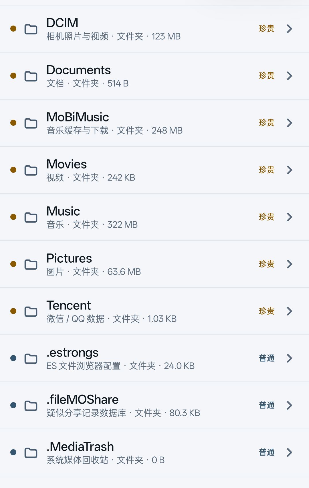

**简体中文** · [English](./README.en.md)

<div align="center">

<h1>存储星图 · StorageAtlas</h1>
<p>把手机里那堆英文目录名，变成一眼看得懂的中文地图。</p>
<p>


</p>
</div>

存储星图是一个 Android 本地存储浏览器。它给每个目录和文件配一句中文备注、标一个重要度，
再通过 App 内自带的 MCP 服务把这些信息交给 AI：读目录、读文件内容、批量写备注、改重要度，
全部在手机本地完成，数据不出设备。

- 纯 Java，没有任何第三方依赖，APK 只有 89 KB
- 不用 Gradle：`./build.sh` 一条命令十几秒出包
- 界面全部自绘，没有 AppCompat / Material 组件库



> 根目录列表：左侧色点是重要度，标题下面是中文备注、体积和修改时间。

## 它能做什么

| 功能 | 说明 |
|---|---|
| 浏览存储 | 从手机内部存储根目录一层层展开，显示体积、子项数、修改时间；支持翻页与排序 |
| 中文备注 | 内置 70 条常见目录路径和 138 个通用词，也可以自己写；备注按存储相对路径保存 |
| 六档重要度 | 系统 / 珍贵 / 项目 / 普通 / 可清 / 空置，色点加右侧标签，可按档筛选 |
| 搜索 | 按文件名、备注、相对路径搜，可限定目录和扩展名 |
| 阅读 | 文本直接预览（前 200 KB），图片看图，二进制给格式和体积 |
| 整理 | 新建文件夹、重命名、删除、收藏到常用 |
| 全盘统计 | 已备注 / 未备注条目数，结果缓存 5 分钟 |
| AI 接口 | 内置 MCP 服务（JSON-RPC 2.0 over HTTP），13 个工具，权限分级 |

## 为什么叫「星图」

Android 根目录下几十个目录，大部分是英文缩写或者包名：`Tencent/MicroMsg`、`Android/obb`、
`.fileMOShare`、`ByteDownload`……系统文件管理器只给名字和体积。存储星图在这些名字旁边写一句话，
再用重要度把「别乱动」「值得留」「随手可清」区分开，让整块存储变成一张有标注的地图。

## AI 接口（MCP）

打开 App → 右上角菜单 →「AI 助手（MCP）」→ 打开「AI 接口服务」，会看到：

- 端点：`http://127.0.0.1:8765/mcp`（端口可改）
- 令牌：App 生成，请求头带 `Authorization: Bearer <令牌>`
- 一键复制的 MCP 客户端配置

默认只监听 `127.0.0.1`；要给电脑或其他设备用，打开「允许局域网访问」。
「允许 AI 写备注 / 改重要度」和「允许 AI 删除文件」是两道独立开关，默认关闭。

| 工具 | 作用 |
|---|---|
| `storage_overview` | 总览：根目录、条目数、六档计数、全盘已备注 / 未备注 |
| `list_dir` | 列目录，支持翻页、排序、只看未备注 |
| `read_file` | 读单个文件的开头或元数据 |
| `read_files` | 一次读最多 20 个文件的开头 |
| `search_files` | 按名称 / 备注 / 路径搜索，可按目录、扩展名、重要度过滤 |
| `set_note` | 写单个备注 |
| `set_notes` | 批量写备注（最多 200 条），返回新增 / 覆盖 / 未变数量并检查合规 |
| `set_level` | 改重要度，单个或批量 |
| `set_favorite` | 收藏 / 取消收藏 |
| `create_folder` | 新建文件夹 |
| `rename_path` | 重命名 |
| `delete_path` | 删除（需在 App 里开启） |
| `annotate_guide` | 返回写备注的完整规则 |

一次调用长这样：

```bash
curl -s http://127.0.0.1:8765/mcp \
  -H 'Authorization: Bearer <令牌>' \
  -H 'Content-Type: application/json' \
  -d '{"jsonrpc":"2.0","id":1,"method":"tools/call","params":{"name":"list_dir","arguments":{"path":"/storage/emulated/0/Download","unannotated":true}}}'
```

完整的参数说明见 [docs/MCP.md](docs/MCP.md)。

**备注规范**（`annotate_guide` 会原样返回）：

- 6~14 个汉字的名词短语，说明「这是什么 / 装什么」
- 不写书名号、句号和其他标点，也不复述文件名
- 拿不准时用「疑似」开头
- 默认不改名、不删文件，除非用户明确要求

## 安装

从 [Releases](https://github.com/CelestialCatkins/StorageAtlas/releases) 下载 APK 直接安装，或者：

```bash
adb install -r storage-atlas-1.6.1.apk
```

首次打开需要在系统设置里授予「所有文件访问权限」（`MANAGE_EXTERNAL_STORAGE`），
否则只能看到有限的目录。要求 Android 8.0（API 26）以上。

## 从源码构建

依赖：

- JDK 17 或更高
- Android SDK：`platforms/android-36`，`build-tools` 里带 `d8` 和 `apksigner`
- `python3`（把 assets 打进 APK）

```bash
git clone https://github.com/CelestialCatkins/StorageAtlas.git
cd StorageAtlas
./build.sh
# 产物：build/storage-atlas.apk
```

| 环境变量 | 默认值 | 说明 |
|---|---|---|
| `ANDROID_HOME` | `/root/android-build/sdk` | SDK 根目录 |
| `ATLAS_BUILD_TOOLS` | SDK 里版本最高的一支 | build-tools 目录 |
| `ATLAS_PLATFORM` | `36` | platforms 下要用的 API 版本 |
| `ATLAS_HOST_TOOLS` | `/root/arm64-tools/build-tools` | 主机原生 `aapt2` / `zipalign`，ARM64 上需要 |
| `VERSION_CODE` / `VERSION_NAME` | `8` / `1.6.1` | 版本号 |
| `ATLAS_KEYSTORE` / `ATLAS_KS_PASS` | `keystore.jks` / `storageatlas` | 签名库；不存在时自动生成 |

x86_64 电脑上一般不用设 `ATLAS_HOST_TOOLS`。ARM64 主机（比如手机上的 Ubuntu）里 SDK 自带的
`aapt2` 是 x86_64 二进制，跑不起来，需要用 ARM64 版本覆盖 —— 这个变量就是为它准备的。

仓库里不含签名库。自己构建时 `build.sh` 会在本地生成一个调试用 `keystore.jks`，
它已在 `.gitignore` 里，请不要提交。

## 项目结构

```
src/com/dshgo/storageatlas/
├── MainActivity.java   主界面：列表、树、搜索、手势
├── Sheets.java         底部面板：条目详情、备注编辑、菜单、MCP 面板
├── McpServer.java      MCP 服务：HTTP、JSON-RPC、13 个工具
├── McpService.java     前台服务，托管 MCP 服务
├── Atlas.java          数据层：备注、重要度、收藏、设置
├── FsNode.java         文件节点
├── RowView.java        列表行（自绘）
├── TreeAdapter.java    树形列表适配器
├── SearchOverlay.java  搜索浮层
├── CompositionBar.java 底部统计条
├── Ui.java             自绘控件与图标
└── Palette.java        配色
assets/builtin.json     内置中文目录词典（tools/gen_data.py 生成）
res/                    图标与主题
tools/                  词典生成、图标预览脚本
```

## 设计取舍

- **不用 Gradle**：只有一个 module、零依赖，Gradle 的配置和下载比构建本身还慢。
  `aapt2 + javac + d8 + zipalign + apksigner` 串起来十几秒出包。
- **不用 AppCompat / Material**：界面基本都是自绘，引组件库只会让 89 KB 变成几 MB。
- **备注按路径存**：SharedPreferences 里存「存储相对路径 → 备注」。文件改名不丢，覆盖同名文件也不会错标。
- **MCP 做在 App 里**：数据本来就在手机上，不必再经电脑中转；AI 连的是本机回环地址。

## 隐私

- 没有账号、没有联网请求、没有统计上报。
- 备注、重要度、收藏、令牌都在 App 私有目录里，卸载即清除。
- MCP 服务默认只听 `127.0.0.1`；开过局域网后请只在可信网络使用，用完关掉。
- 完整浏览内部存储需要「所有文件访问权限」，这是同类工具的硬性要求。

## 已知限制

- 只在 Android 14 / 15 的 ColorOS 上实测过，其他 ROM 的文件权限差异可能有坑。
- 删除不进回收站，直接从文件系统移除。
- 只浏览内部存储，不涉及 SD 卡、U 盘、网盘。
- 内置词库覆盖常见目录，冷门 App 的私有目录要靠 AI 读内容判断。

## 版本

- **1.6.1**：刷新图标改为标准的圆环箭头，与系统图标一致
- **1.6**：当前目录刷新按钮/菜单，刷新后重读目录与体积，保留展开分支和滚动位置
- **1.5**：深层嵌套自适应缩进（20/12/10dp）、12 层内不再刷「第 N 层」、单链中间层不再整列铺绿，超深目录三点兜底
- **1.4**：角标整合重要度、父子字重/字色分级、极淡虚线树形与 20dp 缩进、右侧标签横排弱化
- **1.3**：原地展开后的层级引导线、子项缩进与分组底色，空目录提示
- **1.2**：目录翻页与排序、批量读文件 `read_files`、全盘未备注统计与 5 分钟缓存、
  批量改重要度、`set_notes` 返回更细的结果并检查备注合规
- **1.1**：MCP 服务、搜索、收藏、重要度
- **1.0**：目录树、中文备注、内置词典

## 许可

[MIT](LICENSE) © 2026 CelestialCatkins
